# mdlite

[](https://github.com/mikeruhl/frenetik.mdlite/actions/workflows/ci.yml)
[](https://github.com/mikeruhl/frenetik.mdlite/actions/workflows/security.yml)
[](https://github.com/mikeruhl/frenetik.mdlite/actions/workflows/github-code-scanning/codeql)
[](LICENSE)

A lightweight desktop markdown previewer. Opens fast, renders GitHub-flavored markdown, and live-reloads when the file changes.

Built with [Tauri](https://tauri.app) + [marked](https://github.com/markedjs/marked). ~10MB binary, native webview, no Electron.

## Features

- **Live reload**: file watcher detects edits and re-renders automatically
- **Folder view**: open a directory and browse all markdown files in a sidebar tree
- **Search**: `Ctrl+F` find with regex and case-sensitivity toggles
- **Rich content**: Atlassian-style panels, status lozenges, and expands written in plain GitHub syntax
- **Charts**: `vega-lite` code blocks render as themed charts, with no network access
- **Live Blocks**: `html-live` code blocks run HTML and d3 in an isolated frame, only after you click **Run**
- **Mermaid diagrams**: rendered inline with an option to open in a zoomable/pannable window
- **Math/LaTeX**: inline (`$...$`) and block (`$$...$$`) math via KaTeX
- **Footnotes, task lists, and emoji shortcodes**: GitHub-style `[^1]`, `- [ ]`, and `:rocket:`
- **Full width**: optional reading layout that uses the whole window
- **Window memory**: size, position, and maximized state are restored on the next launch
- **Always on top**: pin the window above your editor or terminal with `Ctrl+Shift+T`
- **Interactive mode**: agents present a decision document with questions and receive the answers as JSON
- **Agent skills**: a Claude Code plugin and cross-agent skills that let agents ask decisions in interactive mode
  and open the markdown they write
- **11 themes**: 7 GitHub variants (light, dark, dark dimmed, dark high contrast, auto, colorblind),
  Splendor, Retro, Air, Modest (persisted across sessions)
- **Fast startup**: native binary, no runtime dependencies
- **Cross-platform**: Windows, macOS, Linux

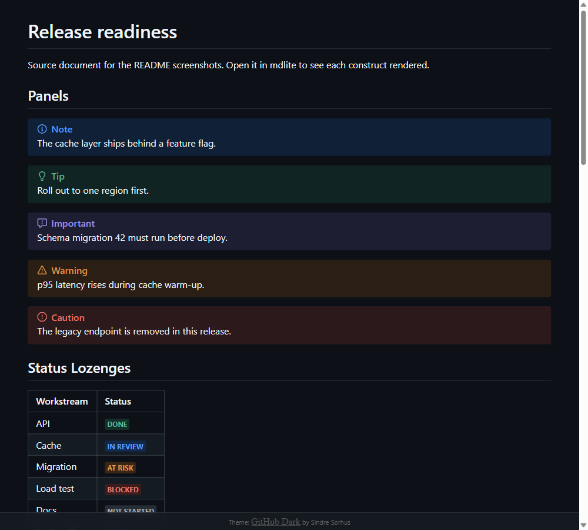

## Install

Download the latest release from the [Releases](../../releases) page.

| Platform              | File             |
| --------------------- | ---------------- |
| Windows               | `.exe` installer |
| macOS (Apple Silicon) | `.dmg`           |
| macOS (Intel)         | `.dmg`           |
| Linux                 | `.AppImage`      |

Or build from source (see below).

### Command line

Agents and scripts run `mdlite` by name, so it must be on `PATH`.

| Platform | Setup                                                                                                               |
| -------- | ------------------------------------------------------------------------------------------------------------------- |
| Windows  | Automatic. The installer adds its folder to your user `PATH` and removes it on uninstall.                           |
| macOS    | Choose **File → Install Command Line Tool** and enter your password. Use **Uninstall Command Line Tool** to undo.   |
| Linux    | `chmod +x /path/to/mdlite.AppImage && mkdir -p ~/.local/bin && ln -sf /path/to/mdlite.AppImage ~/.local/bin/mdlite` |

Restart open terminals and agent sessions afterwards; they do not see `PATH` changes made after they started.
Check with `mdlite --help`.

## Usage

```bash
mdlite <file>
```

```bash
mdlite README.md
mdlite docs/guide.md
mdlite ~/notes/todo.md
```

The window title shows the filename. Edit the file in any editor and the preview updates live.

### Folder view

Open a folder to browse all markdown files in a sidebar tree.

```bash
mdlite docs/
mdlite ~/notes/
```

Or use **File → Open Folder...** from the menu. The sidebar shows a collapsible tree of all `.md`,
`.markdown`, and `.mdx` files. Click a file to preview it. Folders with no markdown descendants are
hidden. If the folder contains a `README.md`, it opens automatically.

A breadcrumb bar above the document shows where the open file sits in the folder. Click a folder in the bar to
reveal it in the tree. Long paths collapse their middle folders into an ellipsis.

Right-click a file or folder in the tree to **Copy Full Path** or **Copy Relative Path** (relative to the opened
folder). **File → Copy File Path** (`Shift+Alt+C`) copies the path of the open file.

### Links

- Links to files inside the open folder open directly.
- Every other link asks first and shows the real destination.
- Markdown files outside the folder open in a new window.
- Non-markdown files open only if their type is listed in **View → Safe File Types**; otherwise they are shown in the
  file manager.
- Web links offer "Always trust" per scheme and host. Manage the list in **View → Trusted Domains**.
- Unsupported link types are blocked.
- Links to network shares are confirmed before mdlite connects.

### Search

Press `Ctrl+F` (or `Cmd+F` on macOS) or use **File → Find...** to open the search bar.

| Control       | Description             |
| ------------- | ----------------------- |
| `.*` button   | Toggle regex mode       |
| `Aa` button   | Toggle case sensitivity |
| `Enter`       | Jump to next match      |
| `Shift+Enter` | Jump to previous match  |
| `Escape`      | Close search bar        |

Matches are highlighted inline. The counter shows your position (e.g. "3 of 12").

### Theme selection

Use the **Theme** menu. Your choice persists across sessions. Panels, lozenges, charts, diagrams, and Live Blocks
follow the active theme.

### Full width

**View → Full Width** widens the document to the window, keeping a margin on each side. The setting persists across
sessions and does not affect printing or PDF export.

### Window position and always on top

mdlite remembers the window size, position, and whether it was maximized, and restores them on the next launch. If the
saved position is on a monitor that is no longer connected, the window opens on the primary monitor instead.

**View → Always on Top** (`Ctrl+Shift+T`, `Cmd+Shift+T` on macOS) keeps the window above other windows. A pin icon in
the top corner shows while it is active; click it to turn it off. The setting persists across sessions.

### Rich content

mdlite renders a few constructs beyond plain markdown. Each one uses syntax that still reads well on GitHub, so the
same file works in both places. [`docs/screenshots/showcase.md`](docs/screenshots/showcase.md) contains every
example below.

#### Panels

GitHub alert syntax renders as colored panels. `NOTE`, `TIP`, `IMPORTANT`, `WARNING`, and `CAUTION` map to info,
success, note, warning, and error tones.

```markdown
> [!WARNING]
> p95 latency rises during cache warm-up.
```

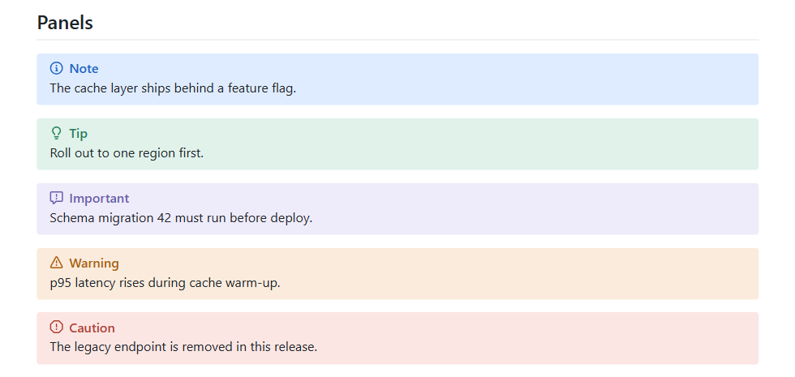

#### Status lozenges

A `<mark>` with a `data-status` attribute renders as a status lozenge. Tones are `neutral`, `info`, `success`,
`warning`, `error`, and `note`; any other value renders as a plain highlight.

```markdown
<mark data-status="success">Done</mark> <mark data-status="error">Blocked</mark>
```

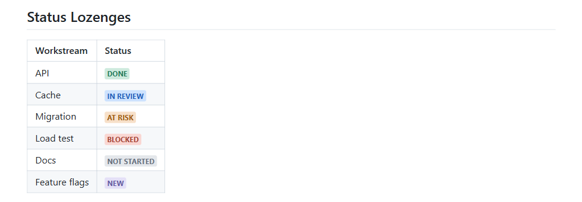

#### Expands

`<details>` renders as a collapsible section, closed unless it has the `open` attribute. Leave a blank line after
`<summary>` so the body is parsed as markdown.

```markdown
<details><summary>Methodology</summary>

Detail a reader may skip.

</details>
```

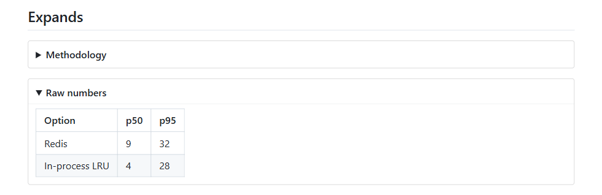

#### Charts

A `vega-lite` code block containing a [Vega-Lite](https://vega.github.io/vega-lite/) JSON spec renders as a chart.
Data must be inline in `data.values`; charts never fetch remote data or follow links. An invalid spec shows an
error in place of the chart and the rest of the document still renders.

````markdown
```vega-lite
{
  "data": { "values": [{ "option": "Redis", "p95": 32 }, { "option": "In-process LRU", "p95": 28 }] },
  "mark": "bar",
  "encoding": {
    "x": { "field": "option", "type": "nominal" },
    "y": { "field": "p95", "type": "quantitative" }
  }
}
```
````

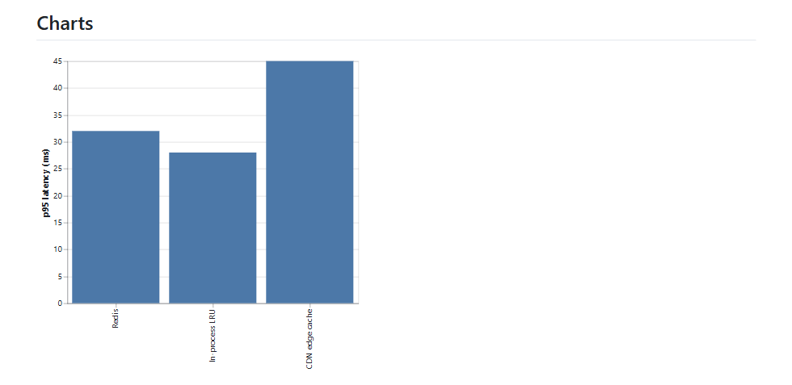

#### Mermaid diagrams

Fenced code blocks with the `mermaid` language tag render as diagrams inline. Hover over a diagram
and click **Open** to view it in a separate window with zoom and pan controls.

````markdown
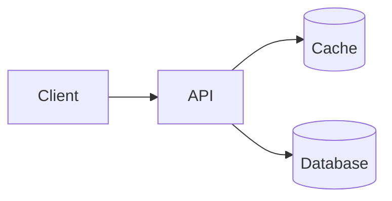
````

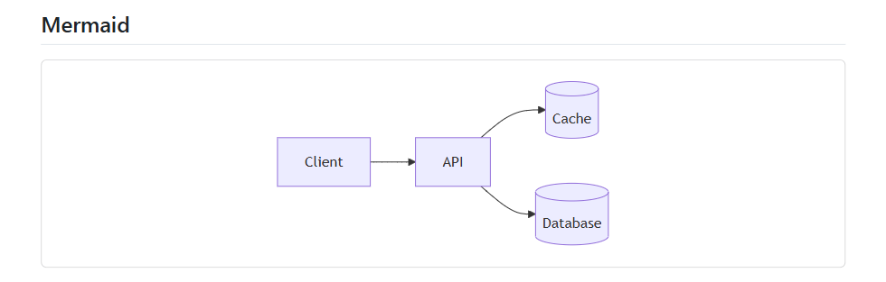

#### Live Blocks

An `html-live` code block holds HTML and script for custom visualizations. It first shows as source with a **Run**
button; nothing executes until you click it. mdlite remembers the choice for that file and asks again if the file
changes.

````markdown
```html-live
<svg id="tree" width="480" height="200"></svg>
<script>
  const root = d3.tree().size([180, 360])(d3.hierarchy(data));
  // ...
</script>
```
````

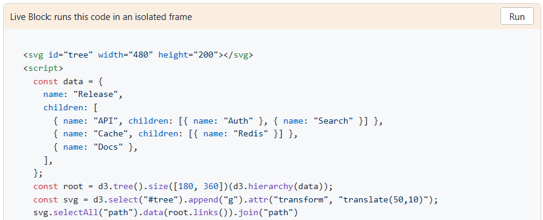

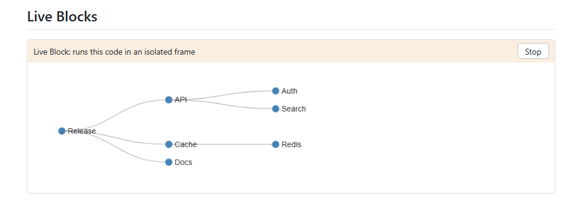

A Live Block runs in an isolated frame. It cannot reach mdlite, the rest of the document, or the network. The
bundled [d3](https://d3js.org) library is available as the global `d3`, and theme colors are exposed as CSS
variables such as `var(--mdlite-fg)`. When printed, a run block appears as a snapshot of its output and an unrun
block as its source.

#### Math

Inline `$...$` and block `$$...$$` math render with [KaTeX](https://katex.org).

```markdown
The p95 estimate is $\hat{q}_{0.95}$, and the mean latency is

$$
\bar{x} = \frac{1}{n} \sum_{i=1}^{n} x_i
$$
```

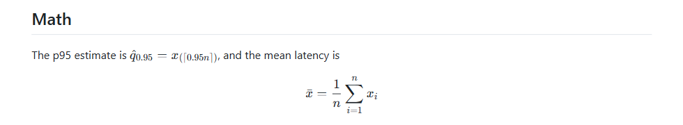

#### Footnotes, task lists, and emoji

GitHub-style footnotes (`[^1]`), task lists (`- [x]`), and emoji shortcodes (`:rocket:`) are supported.

```markdown
Redis was chosen for its eviction policies.[^1]

- [x] Benchmark all three options
- [ ] Run the load test :rocket:

[^1]: See the methodology section above.
```

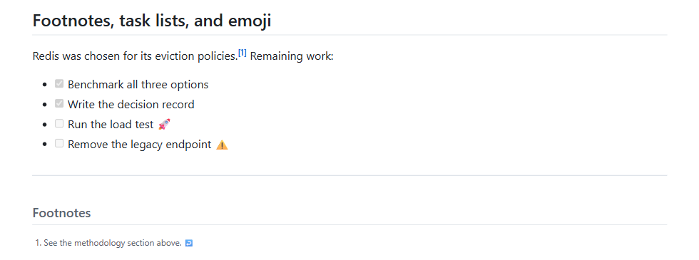

Printing and PDF export wait for charts and diagrams to finish rendering.

### Interactive mode (agent decisions)

An agent can open a decision document with questions beside it and read the answers when the window closes.

```bash
mdlite decision.md --interactive questions.json --output answers.json
```

- Questions appear in the left sidebar. Choose answers and click **Submit** (`Ctrl+Enter`, `Cmd+Enter` on macOS).
- A question with an `anchor` links to `<a id="..."></a>` in the document: `§` jumps to the section, the `Q1`
  badge in the document jumps back, and the question for the section you are reading is highlighted.
- Closing the window cancels. If answers were entered, mdlite asks before discarding them.
- Interactive sessions do not appear in recent files.

The result is one JSON line on stdout, also written to `--output` when given. Stdout carries nothing else;
diagnostics go to stderr.

| Status      | Exit code | Meaning                                       |
| ----------- | --------- | --------------------------------------------- |
| `submitted` | 0         | `answers` holds the responses                 |
| `error`     | 1         | Invalid arguments or questions file (`error`) |
| `cancelled` | 2         | Window closed without submitting              |

On Windows, stdout only reaches the caller when it is piped or redirected. Use `--output` for a reliable result.

The questions schema, answer format, and agent workflow are documented in the agent skill at
[`plugins/mdlite/skills/mdlite-decision/SKILL.md`](plugins/mdlite/skills/mdlite-decision/SKILL.md).

### Agent skills

Two skills ship together. mdlite itself must be installed and on `PATH` (see [Command line](#command-line)).

| Skill             | What the agent does                                                                                             |
| ----------------- | --------------------------------------------------------------------------------------------------------------- |
| `mdlite-decision` | Presents a major decision (tables, diagrams, code, several options) in interactive mode and acts on the answers |
| `mdlite-preview`  | Opens markdown it writes for you to read (reports, plans, reviews) in mdlite instead of only printing the path  |

To stop auto-opening, tell the agent in its instructions file (for example `CLAUDE.md`): "Do not auto-open
markdown in mdlite."

**Claude Code.** Install the plugin from this repository's marketplace. It includes both skills.

```text
/plugin marketplace add mikeruhl/frenetik.mdlite
/plugin install mdlite@mdlite
```

Auto-update is off by default for third-party marketplaces. Turn it on in `/plugin` > **Marketplaces** >
`mdlite` > **Enable auto-update**. To update on demand, refresh the marketplace, then update the plugin and reload:

```text
/plugin marketplace update mdlite
/plugin            (Installed > mdlite > Update now)
/reload-plugins
```

From a shell, `claude plugin update mdlite@mdlite` does the plugin update step.

**Other agents.** The skills follow the open [Agent Skills](https://agentskills.io) format, which Codex, Gemini
CLI, GitHub Copilot, Cursor, and others read. They assume a shell tool that runs a command in the background and
notifies the agent when it exits; they work in any agent that provides one. Install them with the
[`skills`](https://github.com/vercel-labs/skills) CLI, which detects installed agents and places the skills in
each one's skills directory. It asks which skills to install; add `--skill <name>` to pick one.

```bash
npx skills add mikeruhl/frenetik.mdlite
```

Run the same command again to update. To install manually, copy the folders under `plugins/mdlite/skills/` into
your agent's skills directory.

## Build from source

### Prerequisites

- [Node.js](https://nodejs.org) 22.22.2+ or 24.15+
- [pnpm](https://pnpm.io)
- [Rust](https://rustup.rs) stable
- Platform-specific dependencies:
  - **Linux:** `libwebkit2gtk-4.1-dev libappindicator3-dev librsvg2-dev patchelf`
  - **Windows:** Visual Studio Build Tools with C++ workload
  - **macOS:** Xcode Command Line Tools

### Steps

```bash
git clone https://github.com/mikeruhl/frenetik.mdlite.git
cd frenetik.mdlite
pnpm install
pnpm tauri build
```

The binary is at `src-tauri/target/release/mdlite` (or `mdlite.exe` on Windows).

### Development

```bash
pnpm tauri dev -- -- path/to/file.md
```

## Project structure

```text
mdlite/
  index.html                  # App shell
  src/
    main.js                   # Frontend: render, themes, mermaid
    styles.css                # UI chrome (theme bar, mermaid blocks)
    themes/                   # Bundled CSS themes
  src-tauri/
    src/lib.rs                # Backend: CLI, file read, file watcher
    tauri.conf.json           # Tauri config, CLI args, window settings
    capabilities/default.json # Permissions
  public/
    mermaid-viewer.html       # Standalone mermaid zoom/pan viewer
  .github/workflows/
    release.yml               # CI: cross-platform release builds
```

## Themes

| Theme                     | Author                                    | Source                                                                     |
| ------------------------- | ----------------------------------------- | -------------------------------------------------------------------------- |
| GitHub Light              | [Sindre Sorhus](https://sindresorhus.com) | [github-markdown-css](https://github.com/sindresorhus/github-markdown-css) |
| GitHub Dark               | [Sindre Sorhus](https://sindresorhus.com) | [github-markdown-css](https://github.com/sindresorhus/github-markdown-css) |
| GitHub Dark Dimmed        | [Sindre Sorhus](https://sindresorhus.com) | [github-markdown-css](https://github.com/sindresorhus/github-markdown-css) |
| GitHub Dark HC            | [Sindre Sorhus](https://sindresorhus.com) | [github-markdown-css](https://github.com/sindresorhus/github-markdown-css) |
| GitHub Auto               | [Sindre Sorhus](https://sindresorhus.com) | [github-markdown-css](https://github.com/sindresorhus/github-markdown-css) |
| GitHub Light (Colorblind) | [Sindre Sorhus](https://sindresorhus.com) | [github-markdown-css](https://github.com/sindresorhus/github-markdown-css) |
| GitHub Dark (Colorblind)  | [Sindre Sorhus](https://sindresorhus.com) | [github-markdown-css](https://github.com/sindresorhus/github-markdown-css) |
| Splendor                  | [John Otander](https://johnotander.com)   | [markdowncss/splendor](https://github.com/markdowncss/splendor)            |
| Retro                     | [John Otander](https://johnotander.com)   | [markdowncss/retro](https://github.com/markdowncss/retro)                  |
| Air                       | [John Otander](https://johnotander.com)   | [markdowncss/air](https://github.com/markdowncss/air)                      |
| Modest                    | [John Otander](https://johnotander.com)   | [markdowncss/modest](https://github.com/markdowncss/modest)                |

All themes are MIT licensed.

## Contributing

1. Fork the repo
2. Create a branch (`git checkout -b feature/my-feature`)
3. Commit your changes
4. Push and open a pull request

## License

MIT
