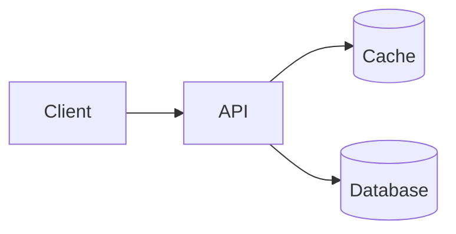

# Rich Blocks sample

Open this file in mdlite 0.4.0 or later to see every rich construct. On GitHub it degrades to alerts, highlighted
text, a collapsible section, and code blocks.

## Panels

Info:

> [!NOTE]
> Background context.

Success:

> [!TIP]
> The recommendation.

Note:

> [!IMPORTANT]
> Something the reader must not miss.

Warning:

> [!WARNING]
> A risk to plan for.

Error:

> [!CAUTION]
> A blocking problem.

## Status Lozenges

<mark data-status="neutral">Not started</mark> <mark data-status="info">In review</mark>
<mark data-status="success">Done</mark> <mark data-status="warning">At risk</mark>
<mark data-status="error">Blocked</mark> <mark data-status="note">New</mark>

## Expand

<details><summary>Methodology</summary>

Collapsed by default. Put detail a reader may skip here.

</details>

## Charts

```vega-lite
{
  "data": {
    "values": [
      { "option": "Redis", "p95": 32 },
      { "option": "In-process LRU", "p95": 28 },
      { "option": "CDN edge cache", "p95": 45 }
    ]
  },
  "mark": "bar",
  "encoding": {
    "x": { "field": "option", "type": "nominal", "sort": null, "title": null },
    "y": { "field": "p95", "type": "quantitative", "title": "p95 latency (ms)" }
  }
}
```

```vega-lite
{
  "data": {
    "values": [
      { "week": 1, "errors": 42 },
      { "week": 2, "errors": 35 },
      { "week": 3, "errors": 21 },
      { "week": 4, "errors": 12 }
    ]
  },
  "mark": { "type": "line", "point": true },
  "encoding": {
    "x": { "field": "week", "type": "ordinal" },
    "y": { "field": "errors", "type": "quantitative", "title": "Errors per day" }
  }
}
```

## Diagram



## Live Block

Click **Run** to draw a force-directed graph with d3. The block runs in an isolated frame with no network access.

```html-live
<svg id="graph" width="360" height="220"></svg>
<script>
  const nodes = d3.range(8).map((i) => ({ id: i }));
  const links = d3.range(1, 8).map((i) => ({ source: Math.floor((i - 1) / 2), target: i }));
  const svg = d3.select("#graph");
  const link = svg.selectAll("line").data(links).join("line").attr("stroke", "var(--mdlite-fg)").attr("stroke-opacity", 0.4);
  const node = svg.selectAll("circle").data(nodes).join("circle").attr("r", 8).attr("fill", "steelblue");
  d3.forceSimulation(nodes)
    .force("link", d3.forceLink(links).distance(40))
    .force("charge", d3.forceManyBody().strength(-120))
    .force("center", d3.forceCenter(180, 110))
    .on("tick", () => {
      link.attr("x1", (d) => d.source.x).attr("y1", (d) => d.source.y).attr("x2", (d) => d.target.x).attr("y2", (d) => d.target.y);
      node.attr("cx", (d) => d.x).attr("cy", (d) => d.y);
    });
</script>
```
