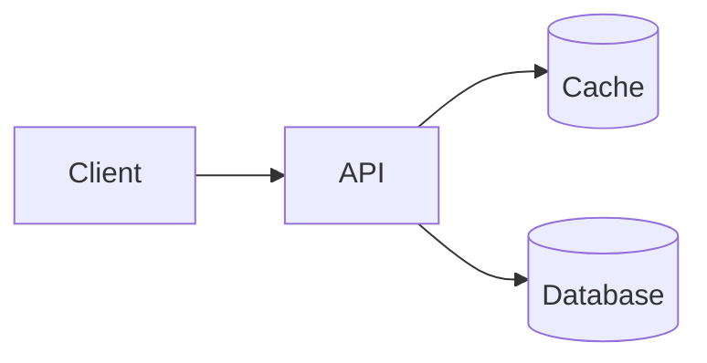

<!-- markdownlint-disable MD028 -->

# Release readiness

Source document for the README screenshots. Open it in mdlite to see each construct rendered.

## Panels

> [!NOTE]
> The cache layer ships behind a feature flag.

> [!TIP]
> Roll out to one region first.

> [!IMPORTANT]
> Schema migration 42 must run before deploy.

> [!WARNING]
> p95 latency rises during cache warm-up.

> [!CAUTION]
> The legacy endpoint is removed in this release.

## Status Lozenges

| Workstream    | Status                                         |
| ------------- | ---------------------------------------------- |
| API           | <mark data-status="success">Done</mark>        |
| Cache         | <mark data-status="info">In review</mark>      |
| Migration     | <mark data-status="warning">At risk</mark>     |
| Load test     | <mark data-status="error">Blocked</mark>       |
| Docs          | <mark data-status="neutral">Not started</mark> |
| Feature flags | <mark data-status="note">New</mark>            |

## Expands

<details><summary>Methodology</summary>

Latency was measured over 24 hours of production traffic replayed against each option.

</details>

<details open><summary>Raw numbers</summary>

| Option         | p50 | p95 |
| -------------- | --- | --- |
| Redis          | 9   | 32  |
| In-process LRU | 4   | 28  |

</details>

## Charts

```vega-lite
{
  "data": {
    "values": [
      { "option": "Redis", "p95": 32 },
      { "option": "In-process LRU", "p95": 28 },
      { "option": "CDN edge cache", "p95": 45 }
    ]
  },
  "mark": "bar",
  "width": 360,
  "encoding": {
    "x": { "field": "option", "type": "nominal", "sort": null, "title": null },
    "y": { "field": "p95", "type": "quantitative", "title": "p95 latency (ms)" }
  }
}
```

## Mermaid



## Live Blocks

```html-live
<svg id="tree" width="480" height="200"></svg>
<script>
  const data = {
    name: "Release",
    children: [
      { name: "API", children: [{ name: "Auth" }, { name: "Search" }] },
      { name: "Cache", children: [{ name: "Redis" }] },
      { name: "Docs" },
    ],
  };
  const root = d3.tree().size([180, 360])(d3.hierarchy(data));
  const svg = d3.select("#tree").append("g").attr("transform", "translate(50,10)");
  svg.selectAll("path").data(root.links()).join("path")
    .attr("fill", "none").attr("stroke", "var(--mdlite-fg)").attr("stroke-opacity", 0.4)
    .attr("d", d3.linkHorizontal().x((d) => d.y).y((d) => d.x));
  const node = svg.selectAll("g").data(root.descendants()).join("g")
    .attr("transform", (d) => `translate(${d.y},${d.x})`);
  node.append("circle").attr("r", 6).attr("fill", "steelblue");
  node.append("text").text((d) => d.data.name).attr("x", 10).attr("dy", "0.32em")
    .attr("fill", "var(--mdlite-fg)").style("font", "13px sans-serif");
</script>
```

## Math

The p95 estimate is $\hat{q}_{0.95} = x_{(\lceil 0.95n \rceil)}$, and the mean latency is

$$
\bar{x} = \frac{1}{n} \sum_{i=1}^{n} x_i
$$

## Footnotes, task lists, and emoji

Redis was chosen for its eviction policies.[^1] Remaining work:

- [x] Benchmark all three options
- [x] Write the decision record
- [ ] Run the load test :rocket:
- [ ] Remove the legacy endpoint :warning:

[^1]: See the methodology section above.
