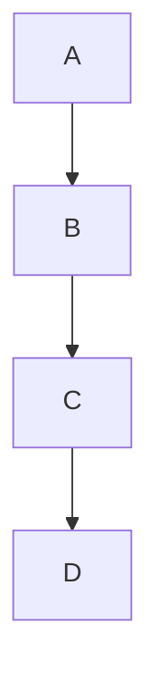

# Manual test plan: harden-document-rendering

> [!CAUTION]
> **Breaking change.** Remote images in existing Documents no longer load until their host is allowed. Each
> blocked image shows a placeholder with **Load once** and **Always allow `<host>`**. Raw HTML `<style>`,
> `<form>`, `<input>`, `<button>`, `<select>`, `<textarea>`, `<option>`, author `style` attributes, and
> non-renderer classes are stripped.

Start from a clean Image Allow-list: remove every host under **View > Allowed Image Hosts**.

## Fixture

Save as `fixture.md` and open it in mdlite:

````markdown
# Fixture


<style>body{display:none}</style>
<form><input name="q"><button>Submit</button></form>
<span class="question-badge" style="color:red">Q1</span>

- [x] done


````

## 1. Remote image placeholders

| #   | Step                                                                         | Expected                                                                                                                      |
| --- | ---------------------------------------------------------------------------- | ----------------------------------------------------------------------------------------------------------------------------- |
| 1.1 | Open the fixture.                                                            | Three placeholders show alt text and host. No request to either host (check with a proxy or firewall log if available).       |
| 1.2 | Click **Load once** on "Remote logo".                                        | That image loads. The other `avatars.githubusercontent.com` image stays blocked. **View > Allowed Image Hosts** is unchanged. |
| 1.3 | Restart mdlite and reopen the fixture.                                       | "Remote logo" is blocked again.                                                                                               |
| 1.4 | Click **Always allow `avatars.githubusercontent.com`**.                      | Both images from that host load. The host appears under **View > Allowed Image Hosts**.                                       |
| 1.5 | Restart mdlite and reopen the fixture.                                       | Both images from that host still load.                                                                                        |
| 1.6 | Click **View > Allowed Image Hosts > Remove avatars.githubusercontent.com**. | The menu entry disappears and both images return to placeholders without reopening the file.                                  |
| 1.7 | Read the "Other host" placeholder action.                                    | It offers **Always allow `upload.wikimedia.org`**, the exact host, not `wikimedia.org`.                                       |

## 2. Sanitization

| #   | Step                                      | Expected                                                                               |
| --- | ----------------------------------------- | -------------------------------------------------------------------------------------- |
| 2.1 | View the fixture.                         | Page is visible (`<style>` removed). No form, text input, or button from the Document. |
| 2.2 | Inspect the `Q1` span.                    | Plain text: no red color, no badge styling.                                            |
| 2.3 | Inspect the task list.                    | One disabled, checked checkbox.                                                        |
| 2.4 | Hover the Mermaid block and a code block. | Mermaid **Open** and code **Copy** controls appear and work.                           |

## 3. Themes

For each of the 11 themes (GitHub Light, GitHub Dark, GitHub Dark Dimmed, GitHub Dark HC, GitHub Auto, GitHub Light
(Colorblind), GitHub Dark (Colorblind), Splendor, Retro, Air, Modest):

- Placeholder border, text, and both action buttons are legible.
- Mermaid diagram renders with theme fills, not solid black.

## 4. Print and PDF timing

Use a Document with 10 or more Mermaid blocks.

| #   | Step                                                                     | Expected                                                                                                  |
| --- | ------------------------------------------------------------------------ | --------------------------------------------------------------------------------------------------------- |
| 4.1 | Open the Document and press **Ctrl+P** immediately.                      | Text appears first. The print dialog opens after the diagrams render; the preview contains every diagram. |
| 4.2 | Reopen and press **Ctrl+Shift+E** immediately. Save the PDF.             | The PDF contains every diagram.                                                                           |
| 4.3 | Repeat 4.1 from **File > Print...**.                                     | Same as 4.1.                                                                                              |
| 4.4 | Optional: throttle rendering (very large diagram) past 10 s, then print. | Toast says diagrams may be incomplete; print proceeds.                                                    |

## 5. Regression

| #   | Area                                           | Expected                                                             |
| --- | ---------------------------------------------- | -------------------------------------------------------------------- |
| 5.1 | Edit the open file in another editor and save. | View updates without reopening.                                      |
| 5.2 | Interactive mode with anchored questions.      | Locate controls scroll to each anchor; submit writes `answers.json`. |
| 5.3 | KaTeX inline and display math.                 | Renders with correct layout.                                         |
| 5.4 | Footnotes.                                     | Reference, footnote section, and back-link work.                     |
| 5.5 | GitHub alerts.                                 | Colored alert with icon.                                             |
| 5.6 | Emoji shortcodes (`:rocket:`).                 | Render as emoji.                                                     |
