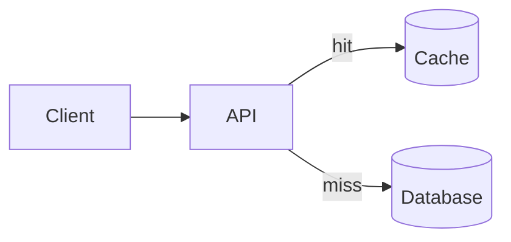

# Caching strategy for the catalog API

The catalog API spends 70% of request time on repeated product lookups. This document compares three caching
options.

> [!TIP]
> **Recommendation: Redis.** It is shared across all instances and survives deploys, so the hit rate stays high
> after every release.

<a id="caching-options"></a>

## Options

| Option         | Status                                           | Shared across instances | Survives deploy | Operational cost    |
| -------------- | ------------------------------------------------ | ----------------------- | --------------- | ------------------- |
| Redis          | <mark data-status="success">Recommended</mark>   | Yes                     | Yes             | New managed service |
| In-process LRU | <mark data-status="warning">Viable</mark>        | No                      | No              | None                |
| CDN edge cache | <mark data-status="neutral">Not evaluated</mark> | Yes                     | Yes             | Cache purge tooling |

Estimated p95 latency per catalog request, from the load test described below:

```vega-lite
{
  "data": {
    "values": [
      { "option": "No cache", "p95": 140 },
      { "option": "Redis", "p95": 32 },
      { "option": "In-process LRU", "p95": 28 },
      { "option": "CDN edge cache", "p95": 45 }
    ]
  },
  "mark": "bar",
  "encoding": {
    "x": { "field": "option", "type": "nominal", "sort": null, "title": null },
    "y": { "field": "p95", "type": "quantitative", "title": "p95 latency (ms)" }
  }
}
```

Redis and the in-process LRU both cut p95 latency by about 75%; the LRU loses that gain after every deploy.

<details><summary>Load test details</summary>

10,000 requests per minute for 30 minutes against a staging copy of the catalog, 80/20 read mix, cache warmed for
5 minutes before measurement.

</details>



<a id="risks"></a>

## Risks

> [!WARNING]
> **Stale data**: product prices change several times a day. Each option needs an invalidation story.

- **Latency**: Redis adds a network hop of about 1 ms per lookup.
- **Cold start**: in-process caches start empty after every deploy.

<a id="rollout"></a>

## Rollout

Ship behind a feature flag, enable for 10% of traffic, and compare p95 latency for one week.
